# 🧠 일반상식 & 건강 퀴즈 게임

## 📌 프로젝트 개요
터미널(콘솔)에서 실행하는 Python 퀴즈 게임입니다.
메뉴에서 번호를 선택해 퀴즈를 풀고, 새 퀴즈를 등록하고, 목록과 최고 점수를 확인할 수 있습니다.
추가한 퀴즈와 최고 점수는 `state.json` 파일에 저장되어 프로그램을 종료했다가 다시 실행해도 유지됩니다.

- 언어: Python 3.10 이상 (외부 라이브러리 없이 표준 라이브러리만 사용)
- 구조: `Quiz`(개별 문제) / `QuizGame`(게임 전체 관리) 2개 클래스로 역할 분리

## 💡 퀴즈 주제와 선정 이유
**주제: 일반상식 + 건강**

- 누구나 한 번쯤 들어봤지만 정확히는 헷갈리는 내용(대양의 크기, 정상 체온, 맥박수 등)이라 퀴즈로 풀었을 때 재미와 학습 효과가 모두 있습니다.
- 건강 상식(물 섭취량, 비타민 C 등)은 일상생활에 바로 도움이 되는 정보라서, 게임을 하면서 실용적인 지식도 얻을 수 있도록 골랐습니다.
- 특정 분야 지식이 없어도 풀 수 있어서 가족·친구 등 다양한 사람이 함께 즐길 수 있습니다.

## ▶️ 실행 방법
1. Python 3.10 이상이 설치되어 있는지 확인합니다.
   ```bash
   python --version
   ```
2. 저장소를 내려받습니다.
   ```bash
   git clone https://github.com/Rosalia0416/quiz_game.git
   cd quiz_game
   ```
3. 프로그램을 실행합니다.
   ```bash
   python main.py
   ```

## 🎮 기능 목록
| 번호 | 기능 | 설명 |
|---|---|---|
| 1 | 퀴즈 풀기 | 저장된 퀴즈를 **랜덤 순서**로 출제하고, 정답/오답과 최종 점수(100점 만점)를 보여줍니다. 최고 점수보다 높으면 갱신합니다. |
| 2 | 퀴즈 추가 | 문제, 선택지 4개, 정답 번호(1~4)를 입력받아 새 퀴즈를 등록하고 파일에 저장합니다. |
| 3 | 퀴즈 목록 | 등록된 모든 퀴즈와 선택지, 정답을 보여줍니다. |
| 4 | 점수 확인 | 최고 점수를 보여줍니다. 아직 풀지 않았다면 안내 메시지를 출력합니다. |
| 5 | 종료 | 데이터를 저장하고 프로그램을 종료합니다. |

**입력/예외 처리**
- 입력 앞뒤 공백 제거, 빈 입력·문자 입력·범위 밖 숫자는 안내 후 다시 입력받습니다.
- `Ctrl+C` 또는 입력 종료(EOF) 시 저장 후 안전하게 종료합니다.
- `state.json`이 없으면 기본 퀴즈로 시작하고, 손상되었으면 안내 후 기본 데이터로 복구합니다.

## 🖼️ 실행 화면

**메뉴 / 미응시 상태 점수 확인**

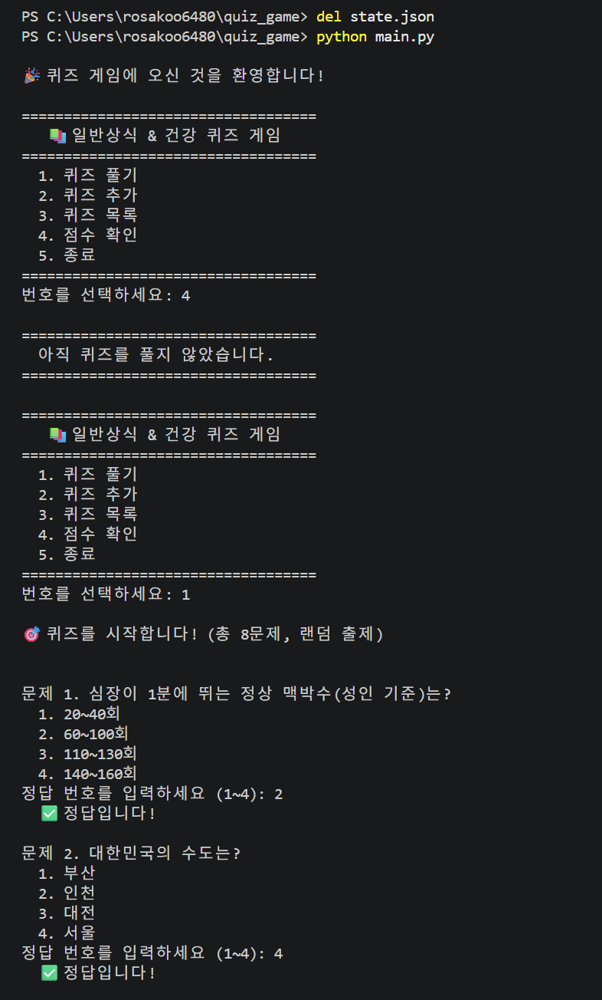

**퀴즈 풀기 (랜덤 출제, 결과 및 최고 점수 갱신)**

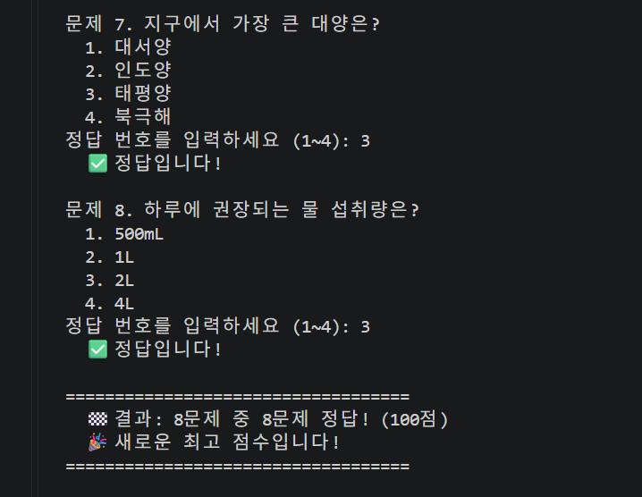

**퀴즈 추가**

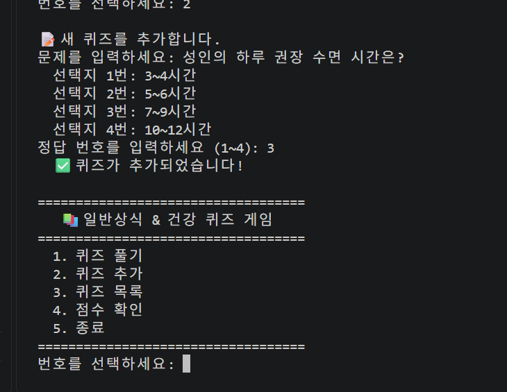

**퀴즈 목록**

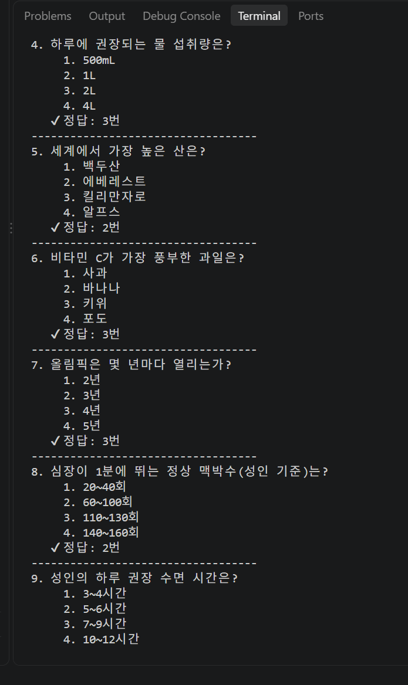

**점수 확인**

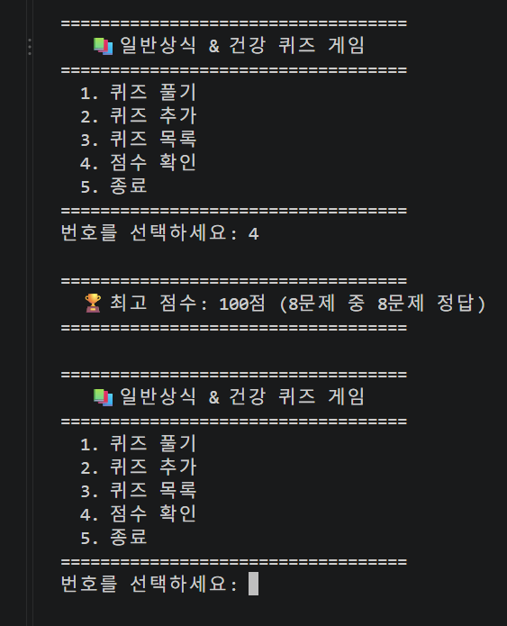

**잘못된 입력 처리 (문자 입력, 빈 입력)**

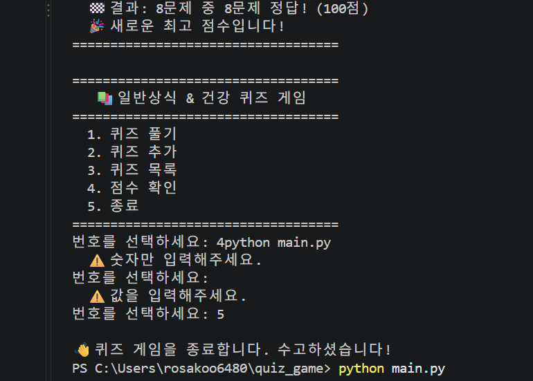

**프로그램 재실행 후 데이터 유지** — 추가한 퀴즈를 포함해 9문제가 출제되고, 89점은 기존 최고 점수(100점)보다 낮아 갱신되지 않음

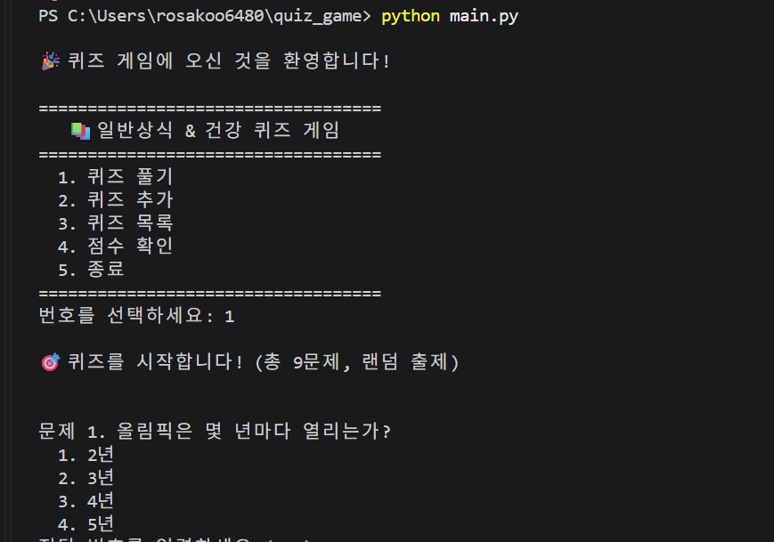

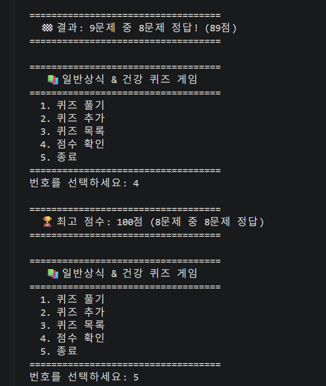

## 📂 파일 구조
```
quiz_game/
├── main.py       # 게임 전체 코드 (Quiz, QuizGame 클래스 + 기본 퀴즈 데이터)
├── state.json    # 퀴즈·최고 점수 저장 파일 (실행 시 자동 생성, Git 추적 제외)
├── .gitignore    # Git에 올리지 않을 파일 목록
├── README.md     # 프로젝트 설명서
├── tools/
│   └── benchmark.py  # 퀴즈 1,000개 / 10,000개 성능 측정 스크립트
└── docs/
    └── screenshots/  # 실행 화면 및 Git 작업 캡처 이미지
```

**main.py 내부 구성**
| 구성 요소 | 역할 |
|---|---|
| `DEFAULT_QUIZZES` | 기본 퀴즈 8개 (state.json이 없거나 손상됐을 때 사용) |
| `Quiz` 클래스 | 문제 1개 표현 — `display()` 출력, `check_answer()` 정답 확인, `to_dict()` / `from_dict()` 저장용 변환 |
| `QuizGame` 클래스 | 게임 전체 관리 — 메뉴, 퀴즈 풀기/추가/목록/점수, 입력 처리(`input_int`), 파일 저장/불러오기 |

## 💾 데이터 파일 설명 (`state.json`)
- **경로:** 프로젝트 루트(`main.py`와 같은 폴더)의 `state.json`
  - 다른 폴더에서 실행해도 항상 이 위치를 사용합니다.
- **역할:** 추가한 퀴즈와 최고 점수를 저장해, 프로그램을 다시 실행해도 데이터가 유지되게 합니다.
- **인코딩:** UTF-8
- **저장 시점:** 퀴즈 풀기 완료, 퀴즈 추가, 종료(또는 `Ctrl+C`) 시
- **Git 추적 제외 이유:** 실행할 때마다 내용이 바뀌는 데이터이므로 `.gitignore`에 등록했습니다. 파일이 없으면 프로그램이 기본 퀴즈로 자동 생성합니다.

**스키마**
```json
{
  "quizzes": [
    {
      "question": "지구에서 가장 큰 대양은?",
      "choices": ["1. 대서양", "2. 인도양", "3. 태평양", "4. 북극해"],
      "answer": 3
    }
  ],
  "best_score": 80,
  "best_correct": 4,
  "best_total": 5
}
```

| 필드 | 타입 | 설명 |
|---|---|---|
| `quizzes` | list | 퀴즈 목록 |
| `quizzes[].question` | str | 문제 |
| `quizzes[].choices` | list[str] | 선택지 4개 |
| `quizzes[].answer` | int | 정답 번호 (1~4) |
| `best_score` | int 또는 null | 최고 점수 (100점 만점). 아직 풀지 않았으면 `null` |
| `best_correct` | int | 최고 점수를 기록했을 때 맞힌 문제 수 |
| `best_total` | int | 최고 점수를 기록했을 때 전체 문제 수 |

**파일 오류 처리**
| 상황 | 동작 |
|---|---|
| 파일 없음 (첫 실행) | 기본 퀴즈 데이터로 시작 |
| JSON 형식이 깨짐 / 구조가 다름 (예: `[]`) | 안내 메시지 출력 후 기본 데이터로 복구하고 파일 다시 저장 |
| 읽기/쓰기 권한 오류 | 안내 메시지 출력 후 계속 실행 |


## 🌿 Git 작업 기록

- **원격 저장소:** https://github.com/Rosalia0416/quiz_game
- **커밋 히스토리:** https://github.com/Rosalia0416/quiz_game/commits/main
- **브랜치:** `main`(배포용), `feature/score`(점수 개선·랜덤 출제 작업용)

### 1) 커밋 히스토리 (`git log --oneline --graph`)
기능 단위로 나눈 의미 있는 커밋 10개 이상, `feature/score` 브랜치가 갈라졌다가 `main`으로 병합된 그래프를 확인할 수 있습니다. 같은 화면에 Python 버전과 Git 사용자 설정도 함께 보입니다.

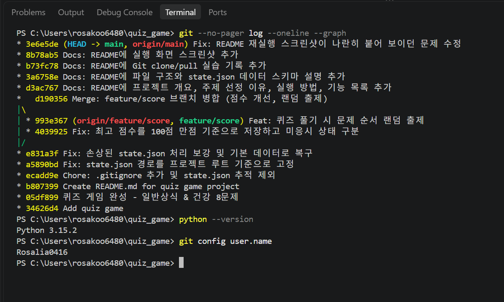

### 2) 브랜치 생성 → 작업 → 병합
| 순서 | 명령어 | 내용 |
|---|---|---|
| 1 | `git checkout -b feature/score` | `main`에서 작업용 브랜치 생성 후 이동 |
| 2 | `git commit` × 2 | 최고 점수 100점 만점 저장(Fix), 랜덤 출제(Feat) |
| 3 | `git checkout main` | `main` 브랜치로 복귀 |
| 4 | `git merge --no-ff feature/score` | 병합 커밋을 남기며 `main`에 병합 |

**브랜치 생성**

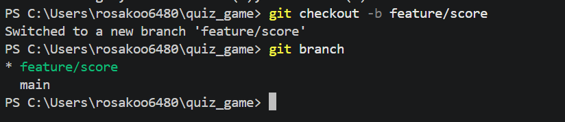

**병합 결과 그래프**

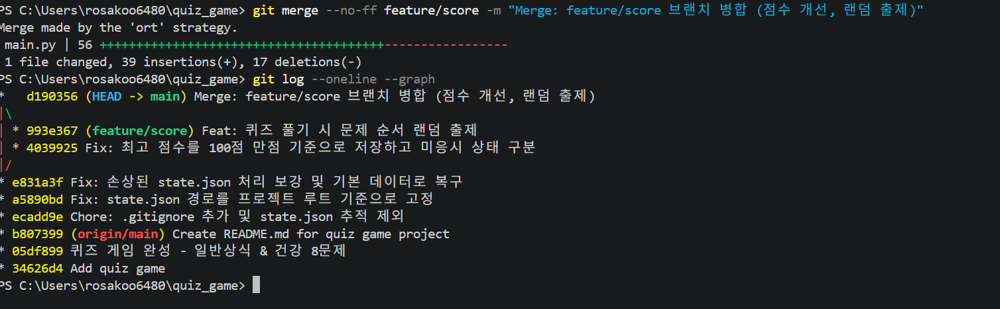

### 3) clone / pull 실습
다른 PC에서 작업하는 상황을 가정하여 같은 저장소를 별도 폴더에 복제한 뒤, 변경 사항을 원래 작업 폴더로 가져왔습니다.

| 순서 | 위치 | 명령어 |
|---|---|---|
| 1 | 상위 폴더 | `git clone https://github.com/Rosalia0416/quiz_game.git quiz_game_clone` |
| 2 | `quiz_game_clone` | README에 한 줄 추가 → `git add` → `git commit` → `git push origin main` |
| 3 | `quiz_game` (기존 폴더) | `git pull origin main` → Fast-forward로 변경 사항 반영 확인 |

- clone한 복제 저장소(quiz_game_clone)에서 이 섹션의 원래 내용을 추가하고 push했습니다. (커밋 `b73fc78`)

**복제 저장소(quiz_game_clone)에서 commit → push**

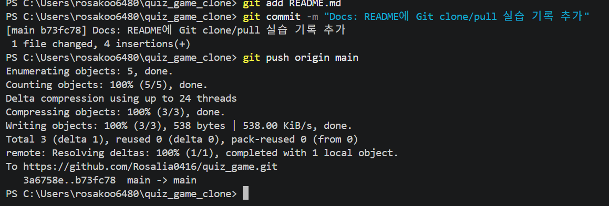

**기존 폴더(quiz_game)에서 pull**

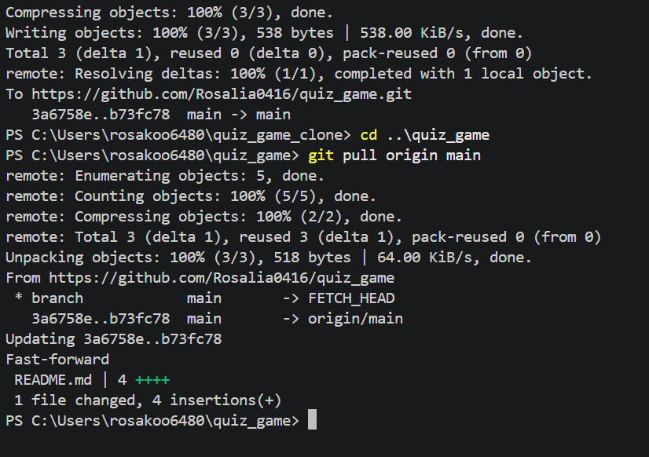

### 4) Git 기본 명령어 7종 사용 내역
| 명령어 | 사용한 곳 |
|---|---|
| `init` | 프로젝트 최초 생성 시 로컬 저장소 초기화 |
| `add` / `commit` | 기능·수정·문서 작업마다 단위별 커밋 |
| `push` | `main`, `feature/score` 브랜치를 GitHub에 업로드 |
| `pull` | GitHub에서 만든 README 가져오기, clone 실습 변경 사항 가져오기 |
| `checkout` | `feature/score` 브랜치 생성·이동, `main` 복귀 |
| `clone` | `quiz_game_clone` 폴더로 저장소 복제 |

## 📏 커밋 규칙

### 메시지 템플릿
```
<타입>: <무엇을 했는지 한 줄 요약>
```
- 요약은 한국어로, "~ 추가 / 구현 / 수정 / 제외"처럼 **변경 내용이 드러나게** 씁니다.
- 예) `Fix: state.json 경로를 프로젝트 루트 기준으로 고정`

### 타입 종류
| 타입 | 사용하는 경우 | 이 저장소의 예시 |
|---|---|---|
| `Feat` | 새로운 기능 추가 | `Feat: 퀴즈 풀기 시 문제 순서 랜덤 출제` |
| `Fix` | 버그 수정, 잘못된 동작 수정 | `Fix: 손상된 state.json 처리 보강 및 기본 데이터로 복구` |
| `Docs` | README 등 문서만 변경 | `Docs: README에 파일 구조와 state.json 데이터 스키마 설명 추가` |
| `Refactor` | 동작은 그대로 두고 코드 구조만 개선 | (예정) |
| `Chore` | 설정 파일 등 기능과 무관한 작업 | `Chore: .gitignore 추가 및 state.json 추적 제외` |
| `Merge` | 브랜치 병합 커밋 | `Merge: feature/score 브랜치 병합 (점수 개선, 랜덤 출제)` |

### 커밋 단위 규칙
1. **한 커밋 = 한 가지 목적.** 기능 추가와 버그 수정을 한 커밋에 섞지 않습니다.
   - 예) 점수 저장 방식 수정(Fix)과 랜덤 출제(Feat)는 같은 브랜치에서 작업했지만 커밋을 나눴습니다.
2. **코드와 문서는 분리**합니다. 코드 변경은 `Feat`/`Fix`, README 변경은 `Docs`로 따로 커밋합니다.
3. **동작하는 상태에서만 커밋**합니다. 커밋 전에 `python main.py`로 실행해 확인합니다.
4. **여러 커밋이 필요한 기능은 브랜치에서 작업**한 뒤 `git merge --no-ff`로 `main`에 병합해 이력을 남깁니다.
5. 실행할 때마다 바뀌는 데이터(`state.json`)와 캐시(`__pycache__/`)는 커밋하지 않습니다. (`.gitignore`로 관리)

## 📈 대용량(퀴즈 1,000개 이상) 처리 분석

### 측정 결과
`tools/benchmark.py`로 테스트용 퀴즈를 만들어 직접 측정했습니다. (실제 `state.json`은 건드리지 않고 임시 폴더에서 측정)

```bash
python tools/benchmark.py
```

| 퀴즈 수 | 파일 크기 | 불러오기 | 저장 | 랜덤 섞기 | 문제 검색 | 메모리(최대) |
|---|---|---|---|---|---|---|
| 1,000개 | 237KB | 4.2ms | 4.2ms | 0.07ms | 0.02ms | 1.10MB |
| 10,000개 | 2,382KB | 40.4ms | 39.3ms | 1.04ms | 0.20ms | 10.05MB |

> 측정 환경: Windows 11, Python 3.15.2. 실행할 때마다 수치는 조금씩 다를 수 있습니다.

### 기능별 시간 복잡도 (n = 퀴즈 수)
| 기능 | 메서드 | 복잡도 | 설명 |
|---|---|---|---|
| 불러오기 | `load_state` | O(n) | JSON 전체를 읽고 Quiz 객체 n개 생성 |
| 저장 | `save_state` | O(n) | 퀴즈 1개만 추가해도 **파일 전체를 다시 씀** |
| 퀴즈 추가 | `add_quiz` | O(1) + 저장 O(n) | 리스트 끝에 추가는 빠르지만 저장이 O(n) |
| 퀴즈 풀기 | `play_quiz` | O(n) | 복사 + `random.shuffle` + 전체 출제 |
| 퀴즈 목록 | `show_quiz_list` | O(n) | 모든 퀴즈를 화면에 출력 |
| 검색 (미구현) | — | O(n) | 리스트를 처음부터 끝까지 확인하는 순차 탐색 |

### 분석
- **성능·메모리:** 1,000개는 불러오기·저장 모두 5ms 안팎, 메모리 약 1MB라서 **현재 구조로 충분**합니다. 시간과 메모리가 퀴즈 수에 비례(O(n))해서 10,000개에서도 0.1초 미만입니다.
- **실제 병목은 사용성:** 1,000개를 한 번에 출제하거나 목록을 한꺼번에 출력하는 것이 속도보다 더 큰 문제입니다.
- **저장 방식:** 퀴즈 1개를 추가할 때마다 파일 전체를 다시 쓰기 때문에, 수십만 개 규모가 되면 저장이 점점 느려집니다.

### 개선 방안
| 문제 | 개선 방법 | 효과 |
|---|---|---|
| 1,000문제를 한 번에 출제 | 풀 문제 수 선택 + `random.sample(self.quizzes, k)` | k문제만 뽑아 O(k)로 출제 |
| 목록이 너무 김 | 한 페이지에 20개씩 나눠 보기(페이지네이션) | 출력량 감소, 보기 쉬움 |
| 문제 검색이 O(n) | 키워드 → 퀴즈 번호 목록을 담은 `dict` 색인 | 검색 평균 O(1) |
| 같은 문제 중복 등록 | 문제 문장을 `set`에 저장해 추가 전에 확인 | 중복 확인 O(1) |
| 추가할 때마다 파일 전체 저장 | 10만 개 이상이면 표준 라이브러리 `sqlite3`로 전환 | 1개 추가 = 1행 INSERT |

## 🔧 요구사항 변경 시 영향도 분석

요구사항이 바뀌었을 때 **어느 파일의 어느 메서드를 고쳐야 하는지** 정리했습니다. 현재 코드는 `main.py` 한 파일에 있습니다.

### 1) 점수 계산 방식 변경
예) 힌트 사용 시 감점, 문제별 배점 다르게 하기

| 수정 대상 | 수정 내용 |
|---|---|
| `QuizGame.play_quiz` | 점수 계산식 `points = round(score / total * 100)` 변경, 최고 점수 비교 로직 |
| `QuizGame.show_best_score` | 점수 표시 문구 |
| `QuizGame.__init__`, `load_state`, `save_state` | 저장할 점수 필드가 늘어나면 함께 추가 |
| README `state.json` 스키마 | 필드 설명 갱신 |

- **영향 없음:** `Quiz` 클래스, `add_quiz`, `show_quiz_list`

### 2) 퀴즈 모델 변경
예) 힌트 속성 추가, 선택지 개수를 4개에서 5개로 변경

| 수정 대상 | 수정 내용 |
|---|---|
| `Quiz.__init__`, `to_dict`, `from_dict` | 새 속성 추가 및 저장/불러오기 변환 |
| `Quiz.display` | 힌트 등 새 정보 출력 |
| `DEFAULT_QUIZZES` | 기본 퀴즈 데이터에 새 필드 추가 |
| `QuizGame.add_quiz` | 새 속성 입력받기, 선택지 반복 `range(1, 5)` 변경 |
| `QuizGame.play_quiz`, `add_quiz` | 정답 입력 범위 `input_int(..., 1, 4)`와 안내 문구 `(1~4)` 변경 |
| `QuizGame.load_state` | 예전 파일에 새 필드가 없을 때 기본값 처리 (`data.get("hint", "")`) |

- **주의:** 선택지 개수 `4`가 `range(1, 5)`, `input_int(..., 1, 4)`, 문구 `(1~4)` 등 **여러 곳에 직접 적혀 있습니다.** 개선하려면 `NUM_CHOICES = 4` 같은 상수 하나로 모아서 한 곳만 고치면 되도록 바꿉니다.

### 3) 데이터 저장 방식 변경
예) JSON 대신 `sqlite3` 데이터베이스 사용, 저장 경로 변경

| 수정 대상 | 수정 내용 |
|---|---|
| `STATE_FILE` | 파일 경로 또는 DB 파일 이름 |
| `QuizGame.load_state` | 읽기 방식 전체 교체 |
| `QuizGame.save_state` | 쓰기 방식 전체 교체 |
| `QuizGame._load_defaults` | 기본 데이터를 DB에 넣는 방식 |
| `.gitignore`, README 데이터 파일 설명 | 새 데이터 파일 반영 |

- **영향 없음:** 메뉴, 퀴즈 풀기/추가/목록/점수 메서드. 이 메서드들은 파일을 직접 다루지 않고 `self.quizzes`, `self.best_score`만 사용하기 때문입니다. 저장 로직을 `load_state` / `save_state` 두 메서드에 모아 둔 덕분에 영향 범위가 좁습니다.

### 4) 메뉴 추가
예) 퀴즈 삭제, 점수 기록 히스토리

| 수정 대상 | 수정 내용 |
|---|---|
| `QuizGame.show_menu` | 메뉴 항목 추가 |
| `QuizGame.run` | `input_int("...", 1, 5)` 범위 변경, `elif` 분기 추가 |
| `QuizGame` | 새 기능 메서드 추가 (예: `delete_quiz`) |
| README 기능 목록 | 새 기능 설명 추가 |
